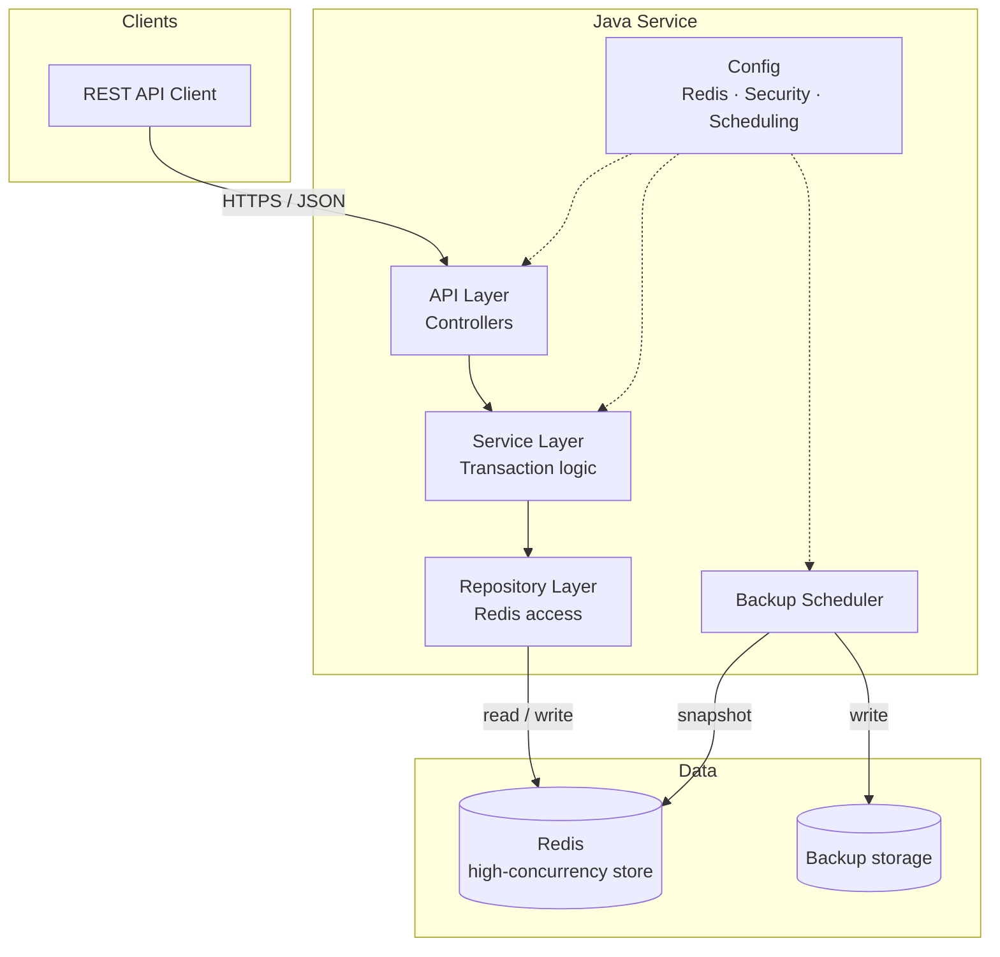
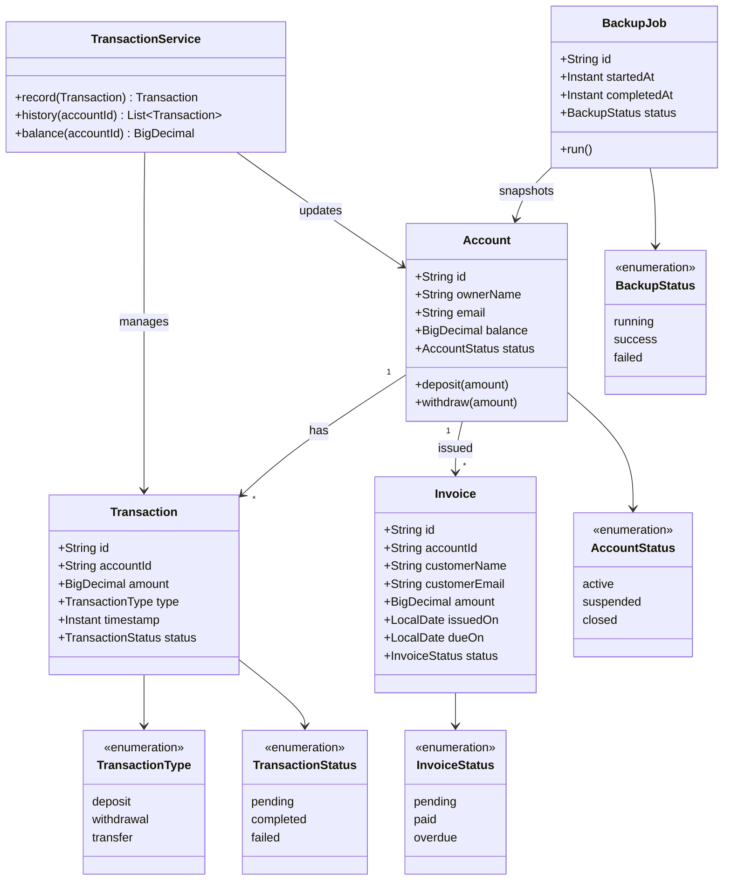
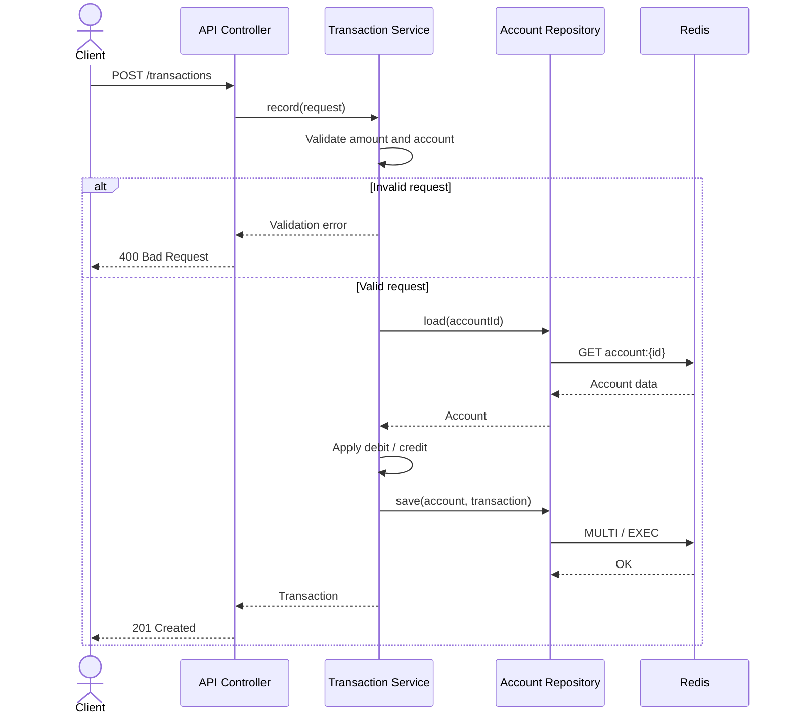
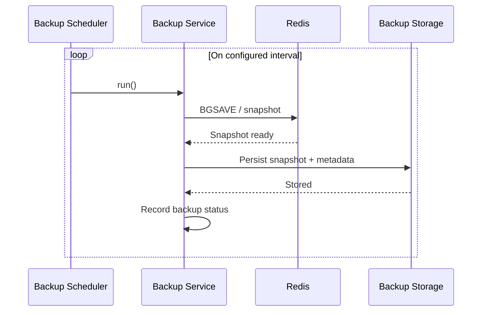

# Financial Tracking & Analytics Suite (fina)

Financial Tracking & Analytics Suite (fina): Developed a secure financial management platform utilizing Java and Redis for high-concurrency transaction processing and automated database backups.

## Overview

fina is a backend-focused financial platform that records transactions, tracks balances, and produces analytics. The core is a Java service backed by Redis for fast, concurrent access, with scheduled backups to protect persisted data.

> **Status:** transition in progress. The previous Next.js frontend has been removed; the Java/Redis service is next to be scaffolded.

## Tech Stack

| Layer | Technology |
| --- | --- |
| Language / runtime | Java |
| Data / cache | [Redis](https://redis.io) — high-concurrency transaction processing |
| Concurrency | [Redisson](https://redisson.org) distributed locks or Redis Lua scripts |
| Persistence | Hybrid RDB + AOF (`appendfsync everysec`) with automated backups |
| High availability | Redis Sentinel or Cluster topology with automated failover |
| API | REST (JSON) |
| Build tool | Maven or Gradle (to be chosen during scaffolding) |

## Getting Started

The Java service has not been scaffolded yet. Once it is, this section will cover:

```bash
# 1. Start Redis
redis-server

# 2. Build and run the service (command depends on the chosen build tool)
./mvnw spring-boot:run   # or: ./gradlew bootRun
```

Prerequisites:

- Java 17 or newer
- Redis 7 or newer
- Maven or Gradle

## Planned Project Structure

```text
fina/
├── src/
│   ├── main/
│   │   ├── java/
│   │   │   └── com/fina/
│   │   │       ├── api/          # REST controllers
│   │   │       ├── service/      # Business logic, transaction handling
│   │   │       ├── repository/   # Redis data access
│   │   │       ├── model/        # Domain entities
│   │   │       ├── backup/       # Scheduled backup jobs
│   │   │       └── config/       # Redis, security, scheduling
│   │   └── resources/
│   │       └── application.yml
│   └── test/java/                # Unit and integration tests
├── docker-compose.yml            # Redis + service for local development
├── README.md
├── CONTRIBUTING.md
├── CODE_OF_CONDUCT.md
└── LICENSE
```

## Features

- Secure handling of accounts and financial transactions
- High-concurrency transaction processing via Redis
- Automated database backups on a schedule
- Analytics over transaction history (balances, spending, trends)
- REST API for clients and integrations

## Architecture Goals

| Concern | Recommended Practice |
| --- | --- |
| Concurrency & locks | Use Redisson's distributed locks or Redis Lua scripts to handle concurrent resource contention safely. |
| Data durability | Enable hybrid RDB + AOF persistence with `fsync everysec` for a strong balance between performance and durability. |
| High availability | Deploy Redis in a Sentinel or Cluster topology to ensure automated failover if the primary node goes down. |

### Persistence Options

| Option | How it works | Trade-off |
| --- | --- | --- |
| **RDB** (Redis Database Snapshots) | Point-in-time snapshots of the dataset stored as compact `.rdb` files at configured time or write intervals (e.g., save after *N* changes every *M* seconds). | Fast restores and compact files, but writes since the last snapshot can be lost. |
| **AOF** (Append-Only File) | Logs every write operation received by the server, synced to disk every second (`fsync everysec`) or on every write. | Maximum durability and a complete operation log, but larger files and slower replay. |
| **Hybrid** (RDB + AOF) | Combines fast point-in-time snapshot restores with complete operation logs. | Best balance of restore speed and durability at the cost of running both mechanisms. |

## UML Diagrams

The diagrams below describe the intended system. They are written in [Mermaid](https://mermaid.js.org) and render directly on GitHub.

### Use Case Diagram


### Architecture Diagram



### Class Diagram



### Sequence Diagram — Record a Transaction



### Sequence Diagram — Automated Backup



## Roadmap

- [ ] Scaffold the Java service and choose Maven or Gradle
- [ ] Configure Redis connection, pooling, and security
- [ ] Add Redisson distributed locks or Lua scripts for concurrent writes
- [ ] Enable hybrid RDB + AOF persistence with `appendfsync everysec`
- [ ] Deploy Redis with Sentinel or Cluster for automated failover
- [ ] Implement accounts, transactions, and invoices
- [ ] Add automated backup and restore workflow
- [ ] Add analytics endpoints (balances, spending, trends)
- [ ] Add authentication and role-based access control
- [ ] Add unit and integration tests
- [ ] Add Docker Compose for local development

## Contributing

Contributions are welcome. Please read [CONTRIBUTING.md](CONTRIBUTING.md) and our [Code of Conduct](CODE_OF_CONDUCT.md) before opening an issue or pull request.

## License

Released under the [MIT License](LICENSE). © 2026 Caleb Ngeno.
