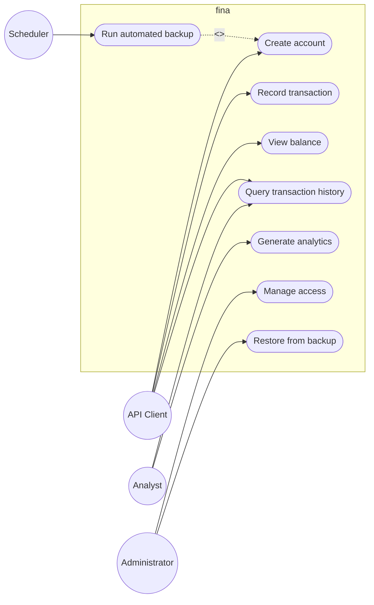
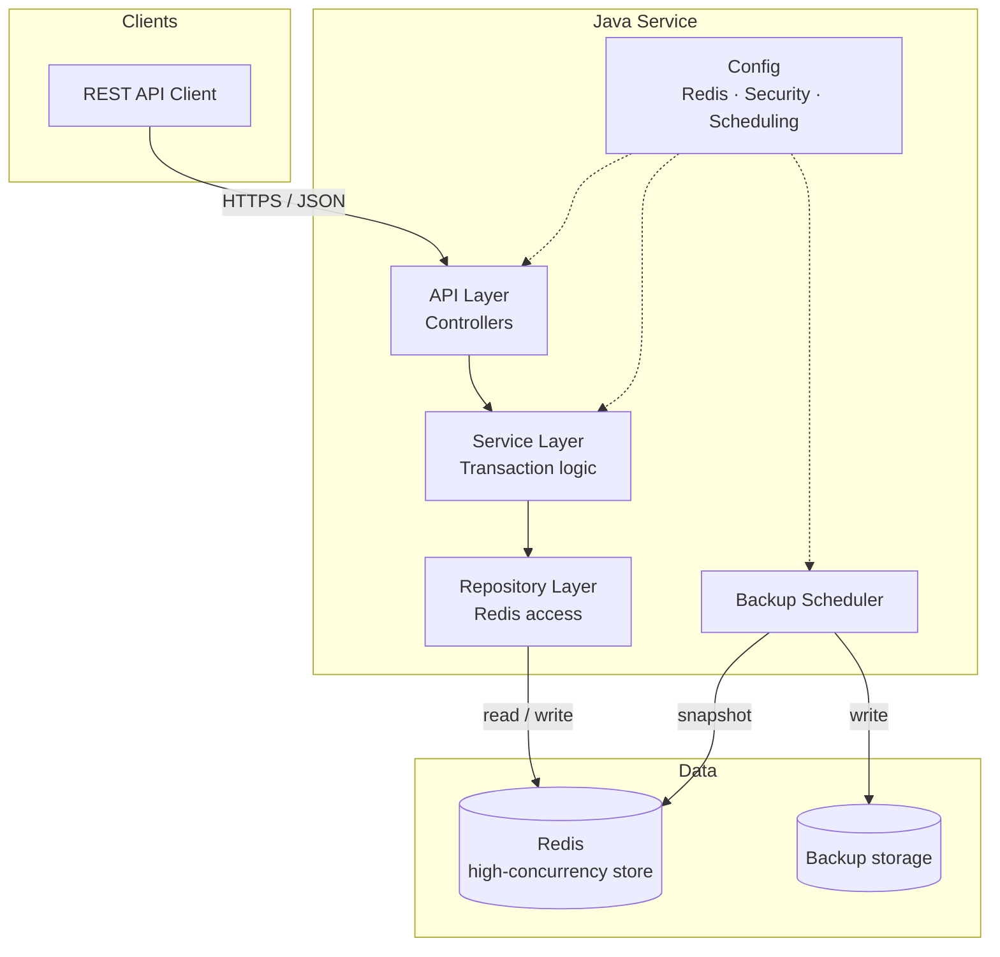
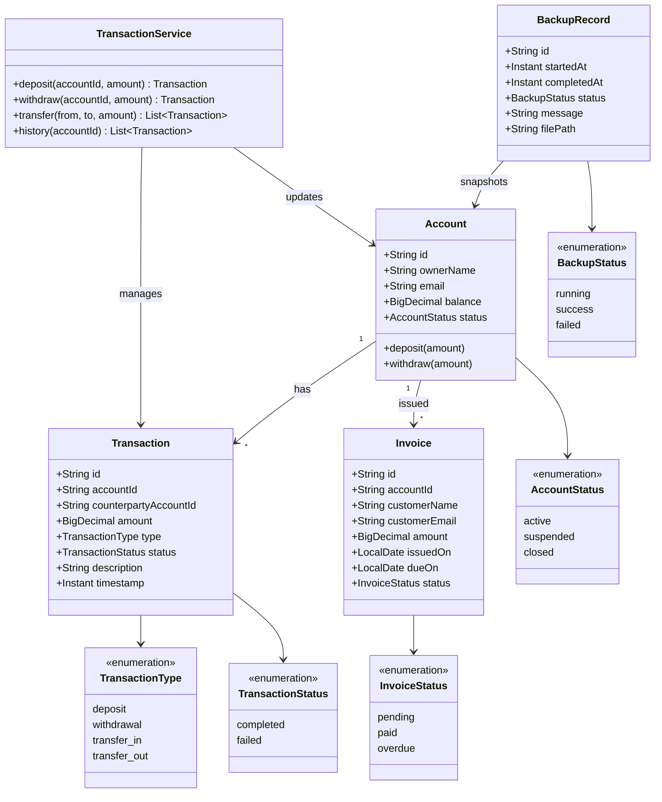
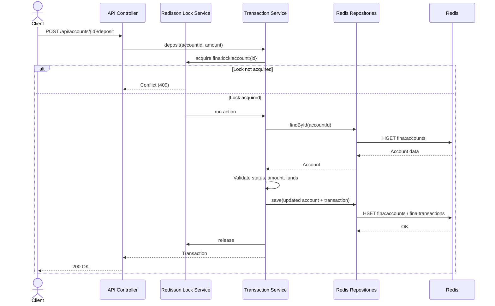
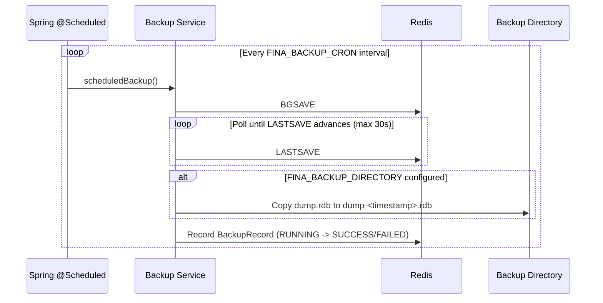

# Financial Tracking & Analytics Suite (fina)

Financial Tracking & Analytics Suite (fina): Developed a secure financial management platform utilizing Java and Redis for high-concurrency transaction processing and automated database backups.

## Overview

fina is a backend-focused financial platform that records transactions, tracks balances, and produces analytics. The core is a Java service backed by Redis for fast, concurrent access, with scheduled backups to protect persisted data.

> **Status:** backend implemented. The previous Next.js frontend has been removed; this repository now contains the Java/Redis service.

## Tech Stack

| Layer | Technology |
| --- | --- |
| Language / runtime | Java 25 |
| Framework | [Spring Boot 4.1](https://spring.io/projects/spring-boot) (Web MVC, Security, Validation, Actuator) |
| Data / cache | [Redis 7](https://redis.io) — high-concurrency transaction processing |
| Concurrency | [Redisson 4.8](https://redisson.org) distributed locks (`RLock` / `MultiLock`) |
| Persistence | Hybrid RDB + AOF (`appendfsync everysec`) with automated backups |
| High availability | Redis Sentinel or Cluster topology with automated failover |
| API | REST (JSON), HTTP Basic auth |
| Build tool | Maven (wrapper included) |
| Tests | JUnit 5 + Mockito |

## Getting Started

### Run with Docker Compose

```bash
docker compose up --build
```

This starts Redis (RDB + AOF enabled) and the API at [http://localhost:8080](http://localhost:8080).

### Run locally

Prerequisites: Java 25, Redis 7.

```bash
# 1. Start Redis (or use: docker compose up -d redis)
redis-server --appendonly yes --appendfsync everysec --save 60 1

# 2. Run the service
./mvnw spring-boot:run
```

The default credentials are `fina` / `fina-local-dev`. Override them with `FINA_USERNAME` and `FINA_PASSWORD`.

```bash
curl -u fina:fina-local-dev http://localhost:8080/api/accounts
```

### Build and test

```bash
./mvnw test              # unit tests
./mvnw package           # build the jar
java -jar target/fina-0.0.1-SNAPSHOT.jar
```

## Project Structure

```text
fina/
├── src/
│   ├── main/
│   │   ├── java/com/fina/
│   │   │   ├── api/              # REST controllers, DTOs, error handling
│   │   │   ├── config/           # Redisson, Redis codec, security
│   │   │   ├── exception/        # Domain exceptions
│   │   │   ├── model/            # Account, Transaction, Invoice, BackupRecord
│   │   │   ├── repository/       # Redis-backed repositories
│   │   │   ├── service/          # Business logic, locking, analytics, backups
│   │   │   └── FinaApplication.java
│   │   └── resources/application.yml
│   └── test/java/com/fina/service/ # Unit tests
├── Dockerfile
├── docker-compose.yml
├── pom.xml
├── README.md
├── CONTRIBUTING.md
├── CODE_OF_CONDUCT.md
└── LICENSE
```

## Features

- Secure handling of accounts and financial transactions (HTTP Basic auth)
- High-concurrency transaction processing with per-account Redisson locks
- Atomic transfers using a `MultiLock` over both accounts
- Automated database backups on a schedule (`BGSAVE` via Spring `@Scheduled`)
- Analytics over transaction history (balances, deposits, withdrawals, invoices)
- Invoice lifecycle with automatic overdue marking
- REST API for clients and integrations

## API Reference

All endpoints except `/actuator/health` and `/actuator/info` require Basic auth.

| Method | Path | Description |
| --- | --- | --- |
| `POST` | `/api/accounts` | Create an account |
| `GET` | `/api/accounts` | List accounts |
| `GET` | `/api/accounts/{id}` | Get an account |
| `POST` | `/api/accounts/{id}/deposit` | Deposit funds |
| `POST` | `/api/accounts/{id}/withdraw` | Withdraw funds |
| `GET` | `/api/accounts/{id}/transactions` | Account transaction history |
| `POST` | `/api/accounts/{id}/close` | Close an account (requires zero balance) |
| `POST` | `/api/transfers` | Transfer between accounts |
| `GET` | `/api/transactions` | List all transactions |
| `GET` | `/api/transactions/{id}` | Get a transaction |
| `POST` | `/api/invoices` | Create an invoice |
| `GET` | `/api/invoices` | List invoices |
| `GET` | `/api/invoices/{id}` | Get an invoice |
| `GET` | `/api/invoices/account/{accountId}` | Invoices for an account |
| `POST` | `/api/invoices/{id}/pay` | Mark an invoice paid |
| `GET` | `/api/analytics/summary` | Platform-wide analytics |
| `GET` | `/api/analytics/accounts/{id}` | Per-account analytics |
| `POST` | `/api/admin/backups` | Trigger an immediate backup |
| `GET` | `/api/admin/backups` | List backup history |

Example:

```bash
curl -u fina:fina-local-dev -X POST http://localhost:8080/api/accounts \
  -H "Content-Type: application/json" \
  -d '{"ownerName":"Ada Lovelace","email":"ada@example.com","initialBalance":100.00}'

curl -u fina:fina-local-dev -X POST http://localhost:8080/api/accounts/{id}/deposit \
  -H "Content-Type: application/json" \
  -d '{"amount":25.50,"description":"salary"}'
```

## Configuration

| Variable | Default | Purpose |
| --- | --- | --- |
| `REDIS_HOST` | `localhost` | Redis host |
| `REDIS_PORT` | `6379` | Redis port |
| `REDIS_PASSWORD` | empty | Redis password |
| `REDIS_DATABASE` | `0` | Redis database index |
| `FINA_USERNAME` | `fina` | API basic-auth username |
| `FINA_PASSWORD` | `fina-local-dev` | API basic-auth password |
| `FINA_BACKUP_ENABLED` | `true` | Enable scheduled backups |
| `FINA_BACKUP_CRON` | `0 0 * * * *` | Backup schedule (hourly) |
| `FINA_BACKUP_DIRECTORY` | empty | Local directory for copied `.rdb` files |
| `FINA_REDIS_DUMP_PATH` | `dump.rdb` | Path to Redis `dump.rdb` |
| `FINA_INVOICE_OVERDUE_CRON` | `0 5 0 * * *` | Daily overdue-invoice sweep |

> Change the default credentials outside local development.

## Architecture Goals

| Concern | Recommended Practice |
| --- | --- |
| Concurrency & locks | Use Redisson's distributed locks or Redis Lua scripts to handle concurrent resource contention safely. |
| Data durability | Enable hybrid RDB + AOF persistence with `fsync everysec` for a strong balance between performance and durability. |
| High availability | Deploy Redis in a Sentinel or Cluster topology to ensure automated failover if the primary node goes down. |

### Persistence Options

| Option | How it works | Trade-off |
| --- | --- | --- |
| **RDB** (Redis Database Snapshots) | Point-in-time snapshots of the dataset stored as compact `.rdb` files at configured time or write intervals (e.g., save after *N* changes every *M* seconds). | Fast restores and compact files, but writes since the last snapshot can be lost. |
| **AOF** (Append-Only File) | Logs every write operation received by the server, synced to disk every second (`fsync everysec`) or on every write. | Maximum durability and a complete operation log, but larger files and slower replay. |
| **Hybrid** (RDB + AOF) | Combines fast point-in-time snapshot restores with complete operation logs. | Best balance of restore speed and durability at the cost of running both mechanisms. |

### Backup Automation

| Approach | How it works |
| --- | --- |
| **Self-hosted automation** | Automated cron jobs or container orchestration tasks (e.g., Kubernetes CronJobs) execute the `BGSAVE` command to trigger background snapshots and stream the resulting `.rdb` files to cloud storage (e.g., AWS S3). |
| **Java-driven backups** | The Java application issues administrative persistence commands (such as `BGSAVE` via Jedis or Redisson) based on scheduled internal triggers (e.g., Spring `@Scheduled` tasks). |

## UML Diagrams

The diagrams below describe the intended system. They are written in [Mermaid](https://mermaid.js.org) and render directly on GitHub.

### Use Case Diagram



### Architecture Diagram



### Class Diagram



### Sequence Diagram — Record a Transaction



### Sequence Diagram — Automated Backup



## Roadmap

- [x] Scaffold the Java service with Maven
- [x] Configure Redis connection and pooling
- [x] Add Redisson distributed locks for concurrent writes
- [x] Enable hybrid RDB + AOF persistence in Docker Compose
- [x] Implement accounts, transactions, and invoices
- [x] Add automated `BGSAVE` backup workflow
- [x] Add analytics endpoints (balances, spending, trends)
- [x] Add authentication
- [x] Add unit tests
- [x] Add Docker Compose for local development
- [ ] Deploy Redis with Sentinel or Cluster for automated failover
- [ ] Add backup restore workflow
- [ ] Stream backups to cloud storage (e.g., AWS S3)
- [ ] Add role-based access control and refresh-token auth
- [ ] Add Redis/Testcontainers integration tests

## Contributing

Contributions are welcome. Please read [CONTRIBUTING.md](CONTRIBUTING.md) and our [Code of Conduct](CODE_OF_CONDUCT.md) before opening an issue or pull request.

## License

Released under the [MIT License](LICENSE). © 2026 Caleb Ngeno.
