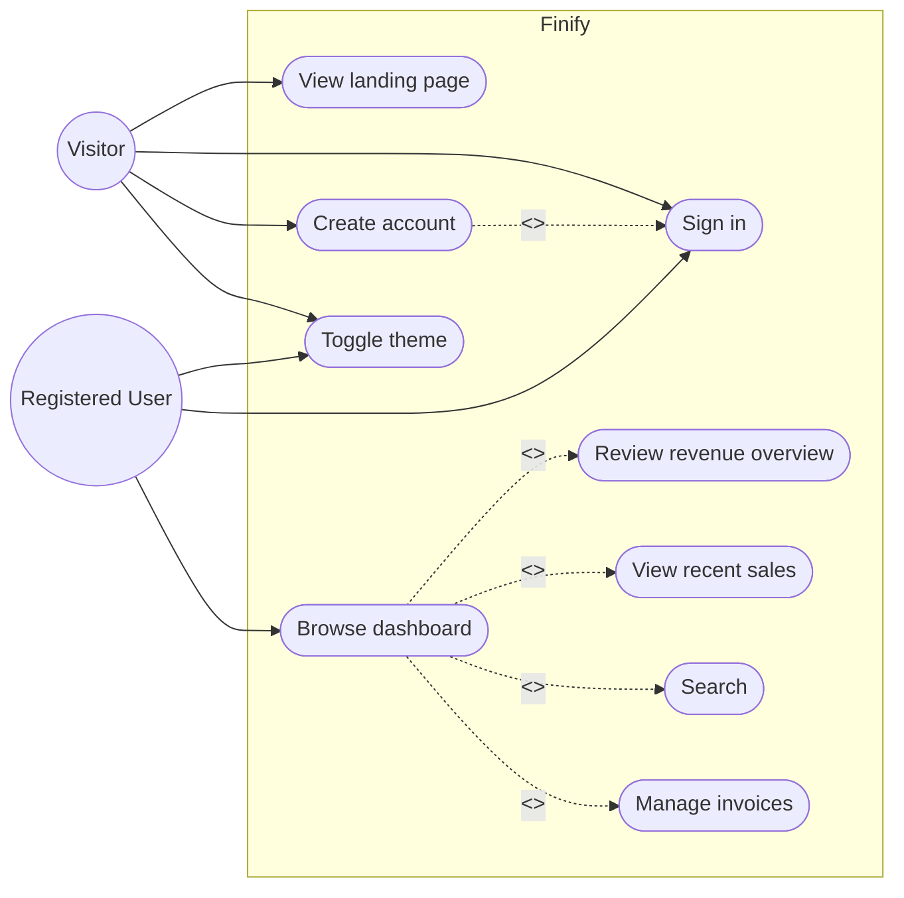
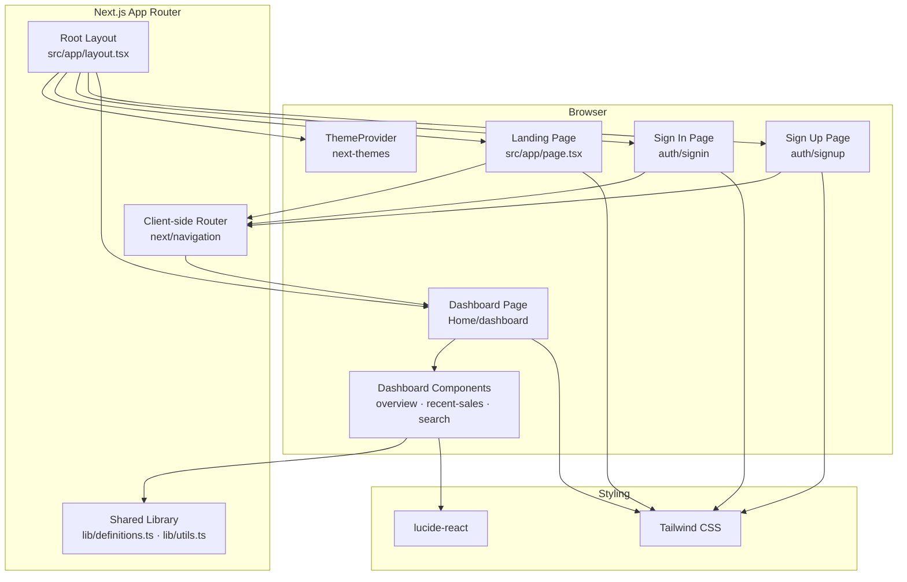
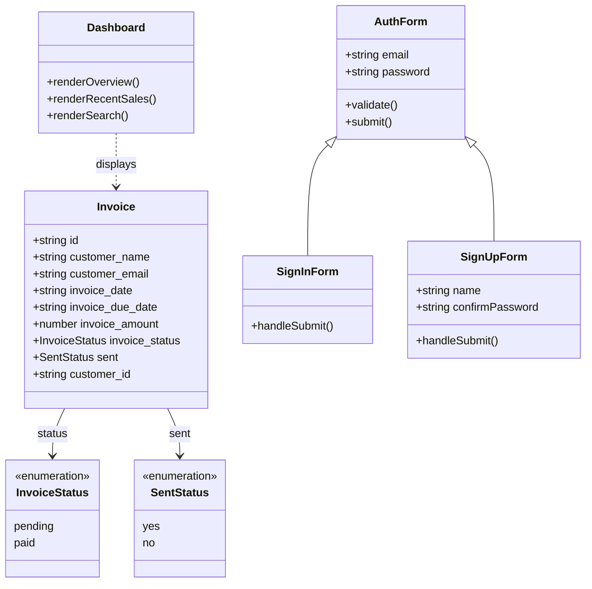
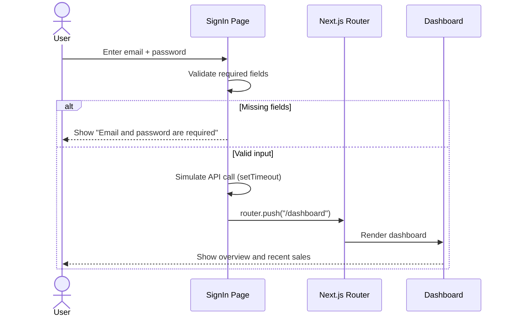
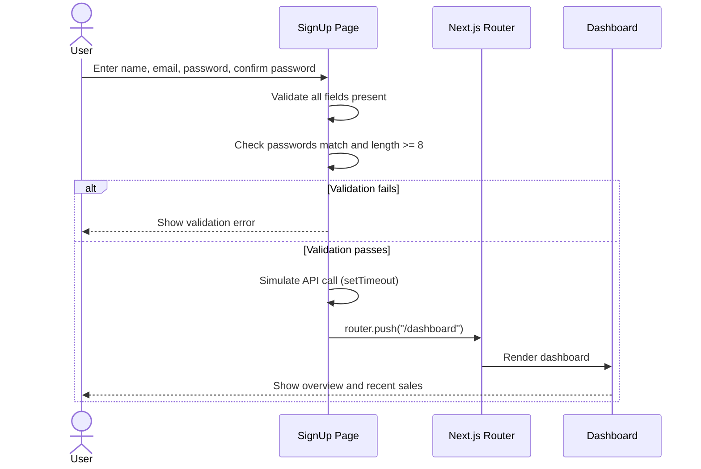

# Finify

Finify is a finance and invoicing web app built with Next.js. It lets users create an account, sign in, and manage invoices from a dashboard with revenue overview, recent sales, and quick search.

> **Status:** early-stage project. Authentication and data are currently simulated on the client; no backend or database is wired up yet.

## Tech Stack

| Layer | Technology |
| --- | --- |
| Framework | [Next.js 15](https://nextjs.org) (App Router, Turbopack) |
| UI | React 19 (RC), [Tailwind CSS](https://tailwindcss.com), [lucide-react](https://lucide.dev) |
| Theming | [next-themes](https://github.com/pacocoursey/next-themes) (light / dark / system) |
| Language | TypeScript |
| Package manager | pnpm (a lockfile is included) |

## Getting Started

Install dependencies and start the development server:

```bash
pnpm install
pnpm dev
```

Open [http://localhost:3000](http://localhost:3000) in your browser.

### Available Scripts

| Script | Description |
| --- | --- |
| `pnpm dev` | Start the dev server with Turbopack |
| `pnpm build` | Create a production build |
| `pnpm start` | Serve the production build |
| `pnpm lint` | Run ESLint via `next lint` |

## Project Structure

```text
fina/
├── public/                          # Static assets
├── src/
│   ├── app/
│   │   ├── layout.tsx               # Root layout + theme provider
│   │   ├── page.tsx                 # Landing page
│   │   ├── auth/
│   │   │   ├── signin/page.tsx      # Sign-in form
│   │   │   └── signup/page.tsx      # Sign-up form
│   │   ├── Home/dashboard/
│   │   │   ├── page.tsx             # Dashboard shell
│   │   │   └── components/          # Dashboard widgets
│   │   ├── components/              # Shared components (button, theme toggle)
│   │   └── ui/                      # UI helpers and styles
│   └── lib/
│       ├── definitions.ts           # Shared TypeScript types (Invoice)
│       └── utils.ts                 # Utility helpers
├── next.config.ts
├── tailwind.config.ts
└── package.json
```

## UML Diagrams

The diagrams below describe the intended system. They are written in [Mermaid](https://mermaid.js.org) and render directly on GitHub.

### Use Case Diagram



### Component / Architecture Diagram



### Class Diagram



### Sequence Diagram — Sign In



### Sequence Diagram — Sign Up



## Roadmap

- [ ] Connect authentication to a real backend / auth provider
- [ ] Persist invoices in a database
- [ ] Wire up invoice creation, editing, and export
- [ ] Enable the Analytics, Reports, and Notifications dashboard tabs
- [ ] Fix auth redirect paths (`/signing` → `/signin`, dashboard route)

## Contributing

Contributions are welcome. Please read [CONTRIBUTING.md](CONTRIBUTING.md) and our [Code of Conduct](CODE_OF_CONDUCT.md) before opening an issue or pull request.

## License

Released under the [MIT License](LICENSE). © 2026 Caleb Ngeno.
