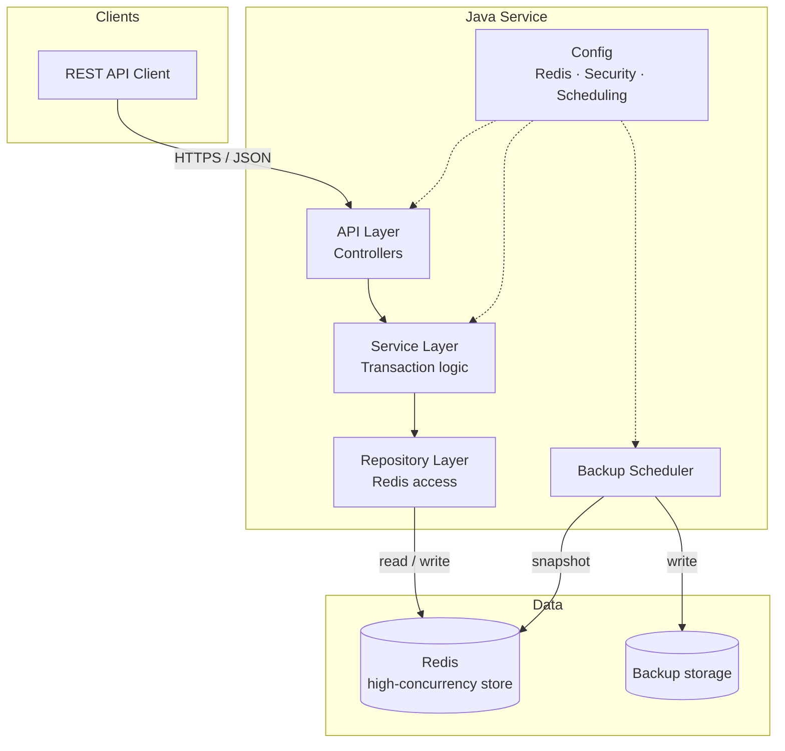
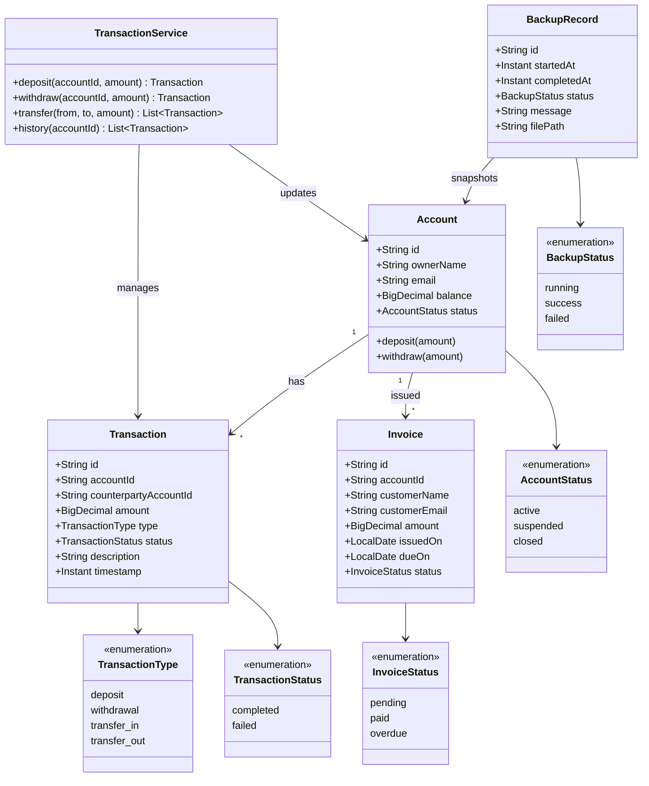
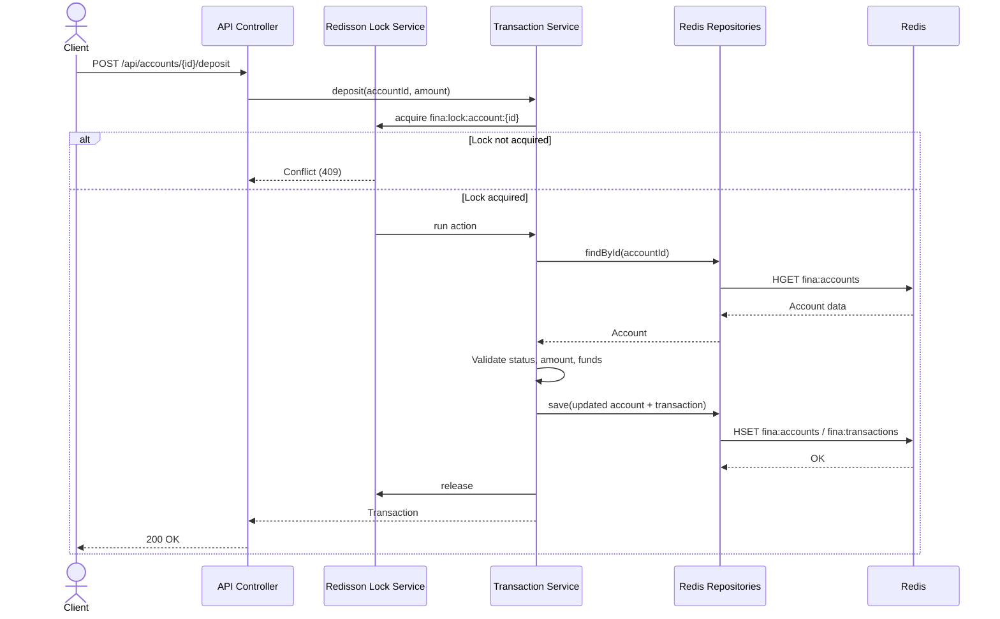
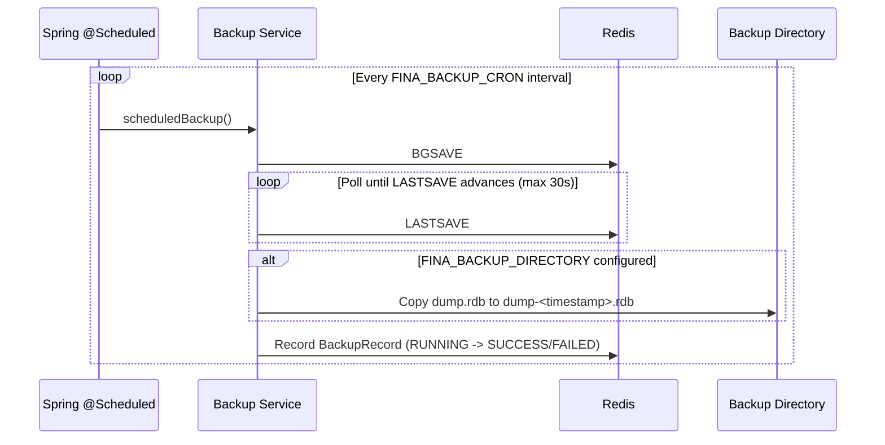

# Financial Tracking & Analytics Suite (fina)

[](https://github.com/ogc16/fina/actions/workflows/ci.yml)
[](https://github.com/ogc16/fina/actions/workflows/cd.yml)
[](https://hub.docker.com/r/kenyaone/fina)

Financial Tracking & Analytics Suite (fina): Developed a secure financial management platform utilizing Java and Redis for high-concurrency transaction processing and automated database backups.

## Overview

fina is a backend-focused financial platform that records transactions, tracks balances, and produces analytics. The core is a Java service backed by Redis for fast, concurrent access, with scheduled backups to protect persisted data.

> **Status:** backend implemented. The previous Next.js frontend has been removed; this repository now contains the Java/Redis service.

## Tech Stack

| Layer | Technology |
| --- | --- |
| Language / runtime | Java 25 |
| Framework | [Spring Boot 4.1](https://spring.io/projects/spring-boot) (Web MVC, Security, Validation, Actuator) |
| Data / cache | [Redis 7](https://redis.io) — high-concurrency transaction processing |
| Concurrency | [Redisson 4.8](https://redisson.org) distributed locks (`RLock` / `MultiLock`) |
| Persistence | Hybrid RDB + AOF (`appendfsync everysec`) with automated backups |
| High availability | Redis Sentinel or Cluster topology with automated failover |
| Accounting | Append-only double-entry ledger (`Assets = Liabilities + Equity`) |
| API | REST (JSON), HTTP Basic auth |
| Observability | Micrometer, Prometheus, Grafana, Alertmanager |
| Deployment | Docker Compose, Kubernetes (Kustomize, HPA, PDB, probes) |
| Build tool | Maven (wrapper included) |
| Tests | JUnit 5 + Mockito + Testcontainers |
| CI/CD | GitHub Actions (test, GHCR, optional Docker Hub) |

## Getting Started

### Run with Docker Compose

```bash
docker compose up --build
```

This starts Redis (RDB + AOF enabled) and the API at [http://localhost:8080](http://localhost:8080). The API is protected by Basic auth, so use the credentials below.

To include the local observability stack, start both Compose files:

```bash
docker compose -f docker-compose.yml -f docker-compose.observability.yml up --build -d
```

| Service | URL | Credentials |
| --- | --- | --- |
| API | [http://localhost:8080](http://localhost:8080) | `fina` / `fina-local-dev` |
| Prometheus | [http://localhost:9090](http://localhost:9090) | none |
| Alertmanager | [http://localhost:9093](http://localhost:9093) | none |
| Grafana | [http://localhost:3000](http://localhost:3000) | `admin` / `admin` (`GRAFANA_ADMIN_USER` / `GRAFANA_ADMIN_PASSWORD`) |

The provisioned **fina overview** dashboard shows scrape health, 5xx ratio, latency percentiles, JVM heap, transaction throughput, ledger posting, and backup age.

### Run locally

Prerequisites: Java 25, Redis 7.

```bash
# 1. Start Redis (or use: docker compose up -d redis)
redis-server --appendonly yes --appendfsync everysec --save 60 1

# 2. Run the service
./mvnw spring-boot:run
```

### Authentication

fina uses HTTP Basic authentication. There is no login page or web UI: when you open a protected URL in a browser, the browser shows its native username/password prompt. That prompt is expected. The root URL `/` is public and returns service metadata; protected API endpoints require the credentials below.

| Setting | Default | Override |
| --- | --- | --- |
| Username | `fina` | `FINA_USERNAME` |
| Password | `fina-local-dev` | `FINA_PASSWORD` |

Enter those values in the browser prompt, or send them explicitly:

```bash
# Public service metadata (no credentials required)
curl http://localhost:8080/

# Protected API request
curl -u fina:fina-local-dev http://localhost:8080/api/accounts

# Public health check (no credentials required)
curl http://localhost:8080/actuator/health

# Protected Prometheus metrics
curl -u fina:fina-local-dev http://localhost:8080/actuator/prometheus
```

For Docker Compose, set the credentials before starting the stack:

```bash
FINA_USERNAME=my-user FINA_PASSWORD='change-me' docker compose up --build
```

On PowerShell:

```powershell
$env:FINA_USERNAME = "my-user"
$env:FINA_PASSWORD = "change-me"
docker compose up --build
```

> Change the defaults outside local development and serve the API over HTTPS. Basic auth sends credentials with every request, so TLS is required in production.

### Build and test

```bash
./mvnw test              # unit tests
./mvnw verify            # unit + Redis integration tests (requires Docker)
./mvnw package           # build the jar (skips tests)
java -jar target/fina-0.0.1-SNAPSHOT.jar
```

The integration suite starts a disposable `redis:7.4-alpine` container with Testcontainers, exercises the full account/transaction/invoice/analytics/backup flow, and verifies that concurrent withdrawals are serialized by the Redisson lock. If Docker is unavailable, the integration test is skipped and the unit tests still run.

## CI/CD

Two GitHub Actions workflows live in `.github/workflows/`:

| Workflow | Trigger | What it does |
| --- | --- | --- |
| `ci.yml` | Push to `master`/`main`, pull requests | Sets up Java 25, runs `./mvnw -B verify`, uploads Surefire reports |
| `cd.yml` | Push to `master`, tags matching `v*` | Re-runs verification, publishes a multi-tag image to GHCR, and optionally publishes to Docker Hub |

The CD workflow publishes to `ghcr.io/ogc16/fina` using the built-in `GITHUB_TOKEN`. Docker Hub publishing is enabled by setting the repository variable `DOCKERHUB_USERNAME` and the repository secret `DOCKERHUB_TOKEN` (a Docker Hub access token, not your password). Without those, the Docker Hub job is skipped.

Published image tags include the branch, commit SHA (`sha-...`), semantic version for `v*` tags, and `latest` on the default branch.

### Published image

The service is available on Docker Hub as [`kenyaone/fina`](https://hub.docker.com/r/kenyaone/fina):

```bash
docker pull kenyaone/fina:latest
```

The container still needs a Redis instance. For example:

```bash
docker network create fina-net 2>/dev/null || true

docker run -d --name fina-redis --network fina-net \
  redis:7.4-alpine redis-server --appendonly yes --appendfsync everysec

docker run --rm -p 8080:8080 --network fina-net \
  -e REDIS_HOST=fina-redis \
  -e FINA_USERNAME=fina \
  -e FINA_PASSWORD=fina-local-dev \
  kenyaone/fina:latest
```

Then open a protected API endpoint and enter the credentials from the [Authentication](#authentication) section.

### Push an image manually

```bash
docker build -t <dockerhub-user>/fina:latest .
docker push <dockerhub-user>/fina:latest
```

Replace `<dockerhub-user>` with your Docker Hub username.

## Deployment

### Observability

The local stack is defined in `docker-compose.observability.yml`. Prometheus scrapes `/actuator/prometheus` with the same Basic-auth credentials as the API, evaluates the rules in `deploy/observability/prometheus/alerts.yml`, and sends alerts to Alertmanager. Grafana provisions the Prometheus datasource and the **fina overview** dashboard.

Alerts cover service availability, 5xx error ratio, p95 latency, failed business transactions, stale or failed backups, and JVM heap pressure. The `backup` health group also reports `DOWN` when the latest successful backup is older than `FINA_BACKUP_MAX_AGE`.

### Kubernetes

Prerequisites:

- `kubectl` and a cluster with an ingress controller (the manifests assume `ingress-nginx`).
- A storage class that supports `ReadWriteMany` for the shared Redis data and backup volumes.
- The Prometheus Operator CRDs only if you apply the monitoring overlay.

Create the runtime secret first; it is intentionally not included in Kustomize:

```bash
kubectl -n fina create secret generic fina-secrets \
  --from-literal=FINA_USERNAME=fina \
  --from-literal=FINA_PASSWORD='change-me' \
  --from-literal=REDIS_PASSWORD='change-me-too'
```

Deploy the base resources:

```bash
kubectl apply -k deploy/k8s/base
```

Then deploy the ServiceMonitor and PrometheusRule after the operator is installed:

```bash
kubectl apply -k deploy/k8s/monitoring
```

The base includes two API replicas, a rolling update with `maxUnavailable: 0`, startup/liveness/readiness probes, an HPA (2–6 replicas at 70% CPU), a PodDisruptionBudget, Redis persistence, and an Ingress for `fina.example.com`. Replace the image and host before production use:

```bash
kubectl -n fina set image deployment/fina app=kenyaone/fina:sha-<commit>
```

Redis mounts `fina-redis-data` at `/data`; the API mounts the same volume read-only at `/redis-data` so the backup service can copy `dump.rdb` to `fina-backups`. If your cluster cannot provide `ReadWriteMany`, use a managed Redis service and stream backups to object storage instead of sharing a filesystem.

## Project Structure

```text
fina/
├── src/
│   ├── main/
│   │   ├── java/com/fina/
│   │   │   ├── api/              # REST controllers, DTOs, error handling
│   │   │   ├── config/           # Redisson, Redis codec, security
│   │   │   ├── exception/        # Domain exceptions
│   │   │   ├── health/           # Backup health indicator
│   │   │   ├── metrics/          # Micrometer business metrics
│   │   │   ├── model/            # Accounts, transactions, invoices, ledger
│   │   │   ├── repository/       # Redis-backed repositories
│   │   │   ├── service/          # Business logic, ledger, locking, backups
│   │   │   └── FinaApplication.java
│   │   └── resources/            # application.yml, application-prod.yml
│   └── test/java/com/fina/       # Unit + Redis integration tests
├── .github/workflows/            # CI/CD pipelines
├── deploy/
│   ├── k8s/                      # Kustomize base + monitoring overlay
│   └── observability/            # Prometheus, Alertmanager, Grafana
├── Dockerfile
├── docker-compose.yml
├── docker-compose.observability.yml
├── pom.xml
├── README.md
├── CONTRIBUTING.md
├── CODE_OF_CONDUCT.md
└── LICENSE
```

## Features

- Secure handling of accounts and financial transactions (HTTP Basic auth)
- Immutable double-entry ledger with balanced journals and a trial-balance endpoint
- High-concurrency transaction processing with per-account Redisson locks
- Atomic transfers using a `MultiLock` over both accounts
- Automated database backups on a schedule (`BGSAVE` via Spring `@Scheduled`)
- Analytics over transaction history (balances, deposits, withdrawals, invoices)
- Invoice lifecycle with automatic overdue marking
- Prometheus metrics, Grafana dashboards, alert rules, and backup health checks
- Kubernetes deployment with probes, HPA, PDB, and graceful shutdown
- REST API for clients and integrations

## API Reference

`/`, `/actuator/health`, `/actuator/health/**` (including `liveness`, `readiness`, and `backup` groups), and `/actuator/info` are public. All other endpoints, including `/actuator/prometheus`, require Basic auth.

| Method | Path | Description |
| --- | --- | --- |
| `POST` | `/api/accounts` | Create an account |
| `GET` | `/api/accounts` | List accounts |
| `GET` | `/api/accounts/{id}` | Get an account |
| `POST` | `/api/accounts/{id}/deposit` | Deposit funds |
| `POST` | `/api/accounts/{id}/withdraw` | Withdraw funds |
| `GET` | `/api/accounts/{id}/transactions` | Account transaction history |
| `POST` | `/api/accounts/{id}/close` | Close an account (requires zero balance) |
| `POST` | `/api/transfers` | Transfer between accounts |
| `GET` | `/api/transactions` | List all transactions |
| `GET` | `/api/transactions/{id}` | Get a transaction |
| `POST` | `/api/invoices` | Create an invoice |
| `GET` | `/api/invoices` | List invoices |
| `GET` | `/api/invoices/{id}` | Get an invoice |
| `GET` | `/api/invoices/account/{accountId}` | Invoices for an account |
| `POST` | `/api/invoices/{id}/pay` | Mark an invoice paid |
| `GET` | `/api/analytics/summary` | Platform-wide analytics |
| `GET` | `/api/analytics/accounts/{id}` | Per-account analytics |
| `POST` | `/api/admin/backups` | Trigger an immediate backup |
| `GET` | `/api/admin/backups` | List backup history |
| `GET` | `/api/admin/ledger/trial-balance` | Debit/credit totals, account-type totals, and accounting-equation status |
| `GET` | `/api/admin/ledger/entries` | List ledger entries; filter with `?accountId={id}` |
| `GET` | `/actuator/prometheus` | Prometheus metrics (Basic auth required) |

Example:

```bash
curl -u fina:fina-local-dev -X POST http://localhost:8080/api/accounts \
  -H "Content-Type: application/json" \
  -d '{"ownerName":"Ada Lovelace","email":"ada@example.com","initialBalance":100.00}'

curl -u fina:fina-local-dev -X POST http://localhost:8080/api/accounts/{id}/deposit \
  -H "Content-Type: application/json" \
  -d '{"amount":25.50,"description":"salary"}'
```

## Double-Entry Accounting

Every financial operation writes a balanced journal: total debits must equal total credits, and each journal must contain at least two lines with positive amounts. Posted ledger rows are immutable; `LedgerRepository` exposes no update or delete operations. Correct a posted journal with a new reversing journal, never by editing history.

The ledger uses these system accounts:

| Account | Type | Purpose |
| --- | --- | --- |
| `system:cash` | Asset | Cash received or paid |
| `system:accounts-receivable` | Asset | Invoices issued but not yet paid |
| `system:revenue` | Equity | Revenue recognized from invoices |
| Customer account IDs | Liability | Funds owed to customers |

Operation postings:

| Operation | Debit | Credit |
| --- | --- | --- |
| Account opening | `system:cash` | customer account |
| Deposit | `system:cash` | customer account |
| Withdrawal | customer account | `system:cash` |
| Transfer | destination customer account | source customer account |
| Invoice issued | `system:accounts-receivable` | `system:revenue` |
| Invoice paid | `system:cash` | `system:accounts-receivable` |

Account balances remain a fast projection for the existing account APIs; the ledger is the authoritative journal. Check the accounting equation at any time:

```bash
curl -u fina:fina-local-dev http://localhost:8080/api/admin/ledger/trial-balance
```

The response includes `totalDebits`, `totalCredits`, `assets`, `liabilities`, `equity`, `balanced` (debits equal credits), and `equationBalanced` (`assets == liabilities + equity`).

## Configuration

| Variable | Default | Purpose |
| --- | --- | --- |
| `REDIS_HOST` | `localhost` | Redis host |
| `REDIS_PORT` | `6379` | Redis port |
| `REDIS_PASSWORD` | empty | Redis password |
| `REDIS_DATABASE` | `0` | Redis database index |
| `FINA_USERNAME` | `fina` | API basic-auth username |
| `FINA_PASSWORD` | `fina-local-dev` | API basic-auth password |
| `FINA_BACKUP_ENABLED` | `true` | Enable scheduled backups |
| `FINA_BACKUP_CRON` | `0 0 * * * *` | Backup schedule (hourly) |
| `FINA_BACKUP_DIRECTORY` | empty | Local directory for copied `.rdb` files |
| `FINA_REDIS_DUMP_PATH` | `dump.rdb` | Path to Redis `dump.rdb` |
| `FINA_BACKUP_MAX_AGE` | `2h` | Maximum age before the `backup` health group reports `DOWN` |
| `FINA_INVOICE_OVERDUE_CRON` | `0 5 0 * * *` | Daily overdue-invoice sweep |
| `PORT` | `8080` | HTTP port |

> Change the default credentials outside local development.

## Architecture Goals

| Concern | Recommended Practice |
| --- | --- |
| Concurrency & locks | Use Redisson's distributed locks or Redis Lua scripts to handle concurrent resource contention safely. |
| Data durability | Enable hybrid RDB + AOF persistence with `fsync everysec` for a strong balance between performance and durability. |
| High availability | Deploy Redis in a Sentinel or Cluster topology to ensure automated failover if the primary node goes down. |

### Persistence Options

| Option | How it works | Trade-off |
| --- | --- | --- |
| **RDB** (Redis Database Snapshots) | Point-in-time snapshots of the dataset stored as compact `.rdb` files at configured time or write intervals (e.g., save after *N* changes every *M* seconds). | Fast restores and compact files, but writes since the last snapshot can be lost. |
| **AOF** (Append-Only File) | Logs every write operation received by the server, synced to disk every second (`fsync everysec`) or on every write. | Maximum durability and a complete operation log, but larger files and slower replay. |
| **Hybrid** (RDB + AOF) | Combines fast point-in-time snapshot restores with complete operation logs. | Best balance of restore speed and durability at the cost of running both mechanisms. |

### Backup Automation

| Approach | How it works |
| --- | --- |
| **Self-hosted automation** | Automated cron jobs or container orchestration tasks (e.g., Kubernetes CronJobs) execute the `BGSAVE` command to trigger background snapshots and stream the resulting `.rdb` files to cloud storage (e.g., AWS S3). |
| **Java-driven backups** | The Java application issues administrative persistence commands (such as `BGSAVE` via Jedis or Redisson) based on scheduled internal triggers (e.g., Spring `@Scheduled` tasks). |

## UML Diagrams

The diagrams below describe the intended system. They are written in [Mermaid](https://mermaid.js.org) and render directly on GitHub.

### Use Case Diagram


### Architecture Diagram



### Class Diagram



### Sequence Diagram — Record a Transaction



### Sequence Diagram — Automated Backup



## Roadmap

- [x] Scaffold the Java service with Maven
- [x] Configure Redis connection and pooling
- [x] Add Redisson distributed locks for concurrent writes
- [x] Enable hybrid RDB + AOF persistence in Docker Compose
- [x] Implement accounts, transactions, and invoices
- [x] Add automated `BGSAVE` backup workflow
- [x] Add analytics endpoints (balances, spending, trends)
- [x] Add authentication
- [x] Add unit tests
- [x] Add Docker Compose for local development
- [x] Add Redis/Testcontainers integration tests
- [x] Add CI/CD with automated image publishing
- [x] Add immutable double-entry ledger and trial balance
- [x] Add Prometheus metrics, Grafana dashboards, and alert rules
- [x] Add Kubernetes manifests with probes, HPA, and PDB
- [ ] Deploy Redis with Sentinel or Cluster for automated failover
- [ ] Add backup restore workflow
- [ ] Stream backups to cloud storage (e.g., AWS S3)
- [ ] Add role-based access control and refresh-token auth

## Contributing

Contributions are welcome. Please read [CONTRIBUTING.md](CONTRIBUTING.md) and our [Code of Conduct](CODE_OF_CONDUCT.md) before opening an issue or pull request.

## License

Released under the [MIT License](LICENSE). © 2026 Caleb Ngeno.
